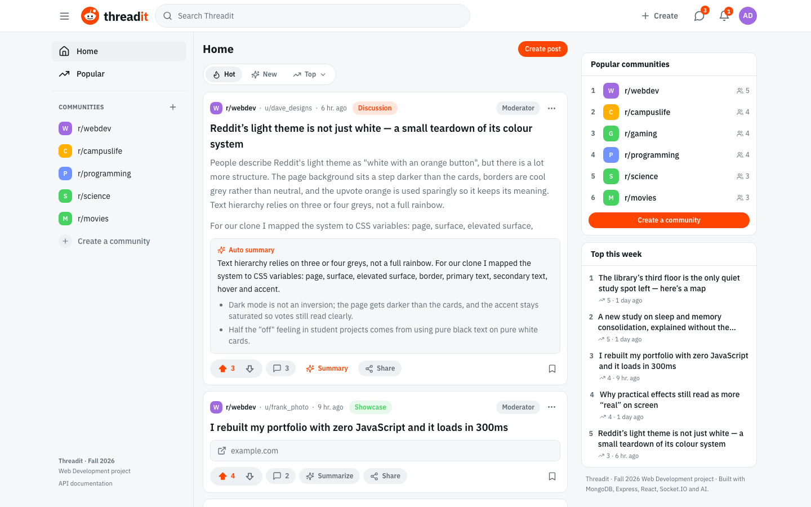
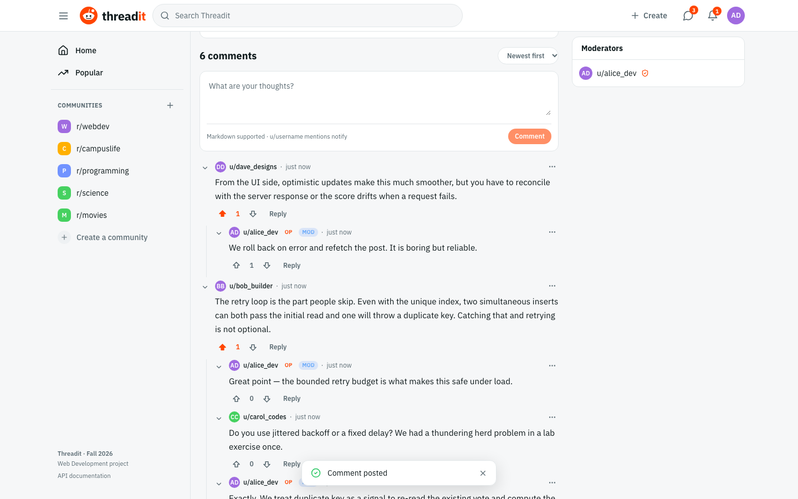
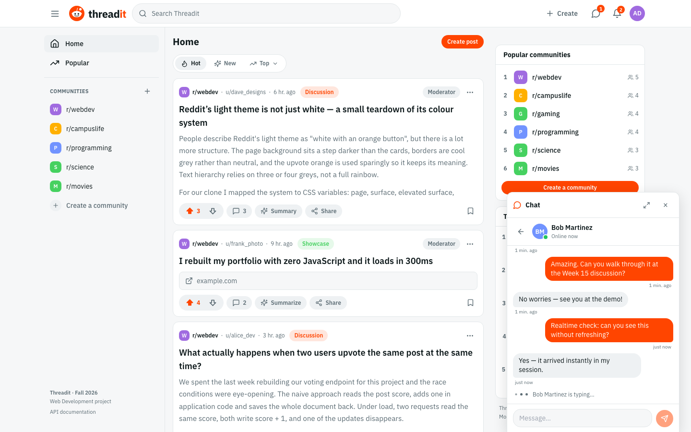
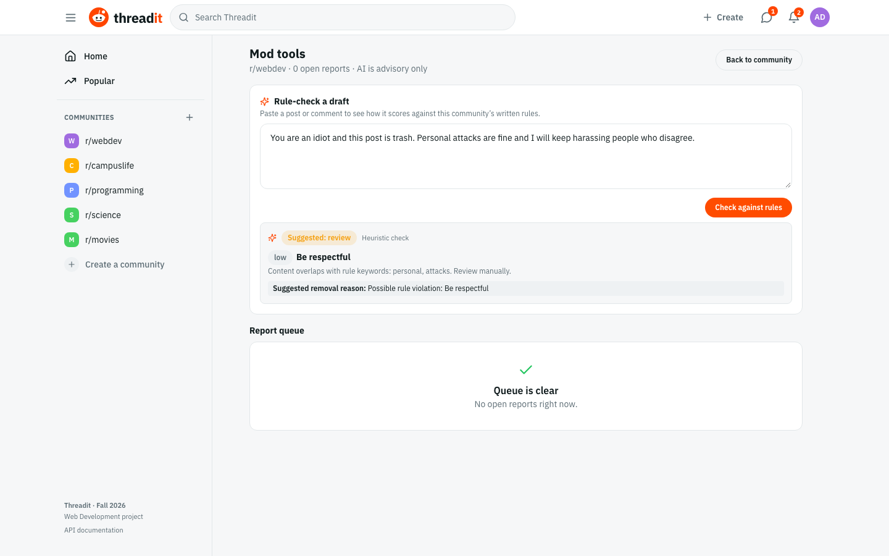
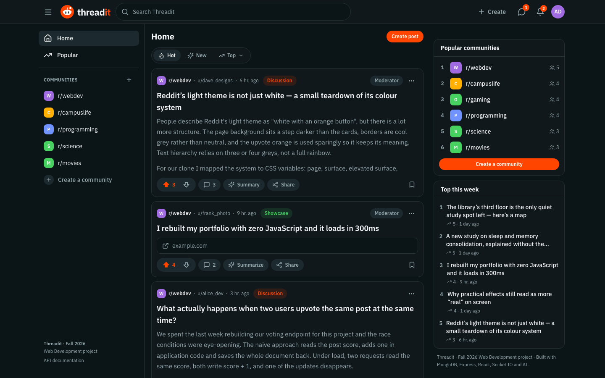
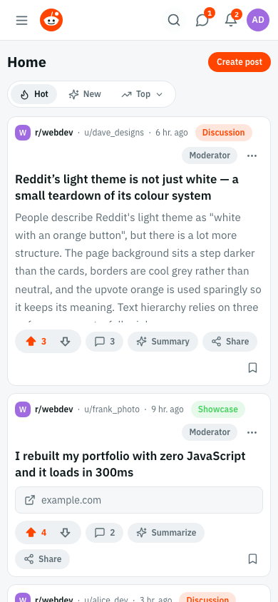

# Threadit — Reddit Clone (Fall 2026 Web Development Project)

A production-shaped **MERN** Reddit clone: MongoDB replica set with ACID transactions, Express REST API, React + Vite + Tailwind frontend, Socket.IO realtime chat/notifications, and an AI summarization layer with graceful offline fallback.

  

---

## Quick start

**Prerequisites:** Node.js 20+, Docker (for the local Mongo replica set) or a MongoDB Atlas connection string.

```bash
# 1. Install dependencies (npm workspaces: server + client)
npm install

# 2. Configure environment
cp .env.example .env          # then edit JWT_SECRET / JWT_REFRESH_SECRET / MONGO_URI

# 3. Start a single-node MongoDB replica set (required for vote transactions)
docker compose up -d
#    ...or point MONGO_URI at MongoDB Atlas (replica set by default).
#    ...or, without Docker: npm run db:memory (in a separate terminal)

# 4. Seed realistic demo data (6 communities, 6 users, votes, threads, chats)
npm run seed

# 5. Run API + frontend together
npm run dev
```

- Web app → <http://localhost:5173>
- API → <http://localhost:5050/api>
- Swagger UI → <http://localhost:5050/api-docs>
- Health check → <http://localhost:5050/api/health>

> Port 5050 is the default because macOS AirPlay Receiver commonly occupies 5000. Override with `PORT`.

**Demo accounts** (after `npm run seed`, password `Password123!`):
`alice_dev` (r/webdev, r/programming mod) · `bob_builder` (r/gaming mod) · `carol_codes` (r/campuslife mod) · `dave_designs` · `erin_editor` · `frank_photo`

> `npm run seed -- --reset` wipes the database first. It refuses to run against `NODE_ENV=production`.

### Environment variables

| Variable | Purpose |
| --- | --- |
| `MONGO_URI` | MongoDB connection string. **Must be a replica set** for transactions. |
| `JWT_SECRET`, `JWT_REFRESH_SECRET` | Sign access (15 min) and refresh (7 day) tokens. |
| `CLIENT_URL`, `CORS_ORIGINS` | Allowed browser origins for CORS and Socket.IO. |
| `CROSS_SITE_COOKIES` | `true` when the SPA and API live on different sites (uses `SameSite=None; Secure`). |
| `AI_PROVIDER`, `AI_API_KEY`, `AI_MODEL_NAME` | `gemini` or `openai`. Without a key the summarizer uses a local extractive fallback. |
| `SEED_PASSWORD` | Password assigned to demo accounts. |

---

## Feature coverage

### 14 basic requirements

| # | Requirement | Where |
| --- | --- | --- |
| 1 | Register / login / logout, bcrypt + JWT access & refresh cookies | `server/src/controllers/authController.js`, `client/src/pages/Login.jsx` |
| 2 | View & edit profile (avatar, banner, bio, karma, cake day, posts/comments) | `Profile.jsx`, `EditProfileModal` |
| 3 | Create community (creator becomes moderator + member) | `communityController.createCommunity` |
| 4 | Join / leave with atomic `memberCount` | `joinCommunity`, `leaveCommunity` |
| 5 | Text / link / image posts with flair | `CreatePost.jsx`, `postController` |
| 6 | Community page with header, rules, join, sort, pagination | `Community.jsx` |
| 7 | Home feed from joined communities; popular fallback for guests | `getFeed` (`scope=home`) |
| 8 | Upvote / downvote / switch / remove with ACID consistency | `services/voteService.js` |
| 9 | Top-level comments, atomic `commentCount` | `commentController.createComment` |
| 10 | Search with typeahead + Communities / People / Posts tabs | `SearchBar.jsx`, `searchController` |
| 11 | Nested replies (materialised path, depth limit, collapsible tree) | `CommentTree.jsx`, `commentTree.js` |
| 12 | New / Top (Today…All time) / Hot sorting + Load more | `usePostFeed`, `postService.fetchPostPage` |
| 13 | Edit / soft-delete own posts & comments (`(edited)`, `[deleted]`) | `postController`, `commentController` |
| 14 | Moderator removal with reason, reports queue, bans | `Moderation` endpoints, `moderationController`, `ModTools.jsx` |
| AI | “Summarize” on every post, server-side cache, rate limit, fallback | `aiService.summarizePost` |

### Bonuses & extra features

- **Realtime chat (+5%)** — Socket.IO DMs and group chats, persisted history, unread counts, typing indicators, online presence, floating drawer + full `/chat` page.
- **Deployment readiness (+5%)** — single-origin Render blueprint (`render.yaml`), separate Vercel/Render topology documented below, `/api/health`, SPA rewrite config, environment-based CORS/cookies.
- **AI Thread TL;DR & sentiment pulse** — consensus, counterpoints and tone for any comment tree (`POST /posts/:id/comments/summarize`).
- **AI Mod-Assist** — a `/r/:name/mod` page lists open reports, scores reported content or a pasted draft against the community's written rules, and suggests an action + removal reason (`POST /ai/mod-check`), always human-in-the-loop.
- **Comment voting & karma** — the vote engine handles `targetType: 'comment'` and updates `commentKarma` on the author.
- **Flairs, reports, notifications & `u/` mentions** — community flair filters, mod report queue, live bell notifications over Socket.IO.
- **Saved posts, light/dark theme, responsive 3-column layout** — Reddit-style sticky top bar, collapsible sidebar, right rail, mobile drawer.

---

## Architecture

```
.
├── client/                    React 18 + Vite + Tailwind SPA
│   └── src/
│       ├── components/        Navbar, Sidebar, PostCard, CommentTree, Chat*, …
│       ├── context/           Auth, Socket, Chat, Theme, Toast
│       ├── hooks/             usePostFeed (infinite query), useCommunity
│       ├── lib/               API client (token refresh), formatting, markdown
│       └── pages/             Home, Popular, Community, PostDetail, Profile, …
├── server/
│   ├── src/
│   │   ├── config/            env validation + Mongoose connection guards
│   │   ├── controllers/       HTTP layer (thin, validated)
│   │   ├── middleware/        auth, validation, rate limits, uploads, errors
│   │   ├── models/            User, Community, Membership, Post, Comment, Vote, …
│   │   ├── routes/            REST routing
│   │   ├── services/          vote engine, AI, chat, notifications, comment tree
│   │   ├── sockets/           Socket.IO auth + chat/presence/typing
│   │   ├── docs/              OpenAPI 3 spec + exporter
│   │   └── seed.js            idempotent demo data
│   └── tests/                 Vitest + mongodb-memory-server replica set
├── e2e/                       Playwright browser walkthrough (7 flows)
├── playwright.config.js       Headless Chromium, 1440×900 desktop default
└── docs/                      ERD, contributions, generated OpenAPI/Postman, screenshots
```

**Data flow:** React Query → REST/Socket.IO → controllers → services → Mongoose. Votes and comment creation use multi-document transactions; notifications are created after the transaction commits and pushed through a small realtime registry (`sockets/realtime.js`) so services never import the socket server directly.

---

## The concurrency-safe voting engine

Requirement: *“Each user can have at most one vote per post; switching or removing a vote must update the score correctly even when several votes are submitted at the same time.”*

1. **Storage-level uniqueness.** Votes live in their own collection with
   `unique index { userId: 1, targetId: 1, targetType: 1 }` — a second active vote is impossible, even if application code races.
2. **One ACID transaction.** Vote insert/update/delete + `$inc` on the target `score` + `$inc` on the author's karma commit together in `session.withTransaction(...)`. A crash can never leave score and votes out of sync.
3. **Exact deltas, not read-modify-write.** Atomic `$inc: { score: delta }`:

   | Previous | Requested | Vote document | Score delta |
   | --- | --- | --- | --- |
   | none | `+1` | insert | `+1` |
   | none | `-1` | insert | `-1` |
   | `+1` | `+1` or `0` | delete (toggle off) | `-1` |
   | `-1` | `-1` or `0` | delete (toggle off) | `+1` |
   | `+1` | `-1` | update to `-1` | `-2` |
   | `-1` | `+1` | update to `+1` | `+2` |

4. **Bounded retries.** `WriteConflict` (112), `DuplicateKey` (11000) and `TransientTransactionError` retry up to 5 times with 15–50 ms jittered backoff. `withTransaction` also retries transient aborts internally.
5. **Karma in the same unit of work.** Votes on posts update `postKarma`; comments update `commentKarma`.

### Stress tests (`npm test`)

Vitest spins up a **real single-node MongoDB replica set** via `mongodb-memory-server`, so transactions are genuinely exercised (no mocks):

- **Same-user storm:** 20 simultaneous up/down/remove requests → exactly 0–1 vote documents remain, `post.score === remaining vote value`, author karma matches.
- **Multi-user storm:** 50 different users upvote concurrently → score `50`, 50 vote documents, no lost updates.
- **Unique index proof:** a second identical vote insert is rejected with `11000`.
- **Concurrent joins:** three simultaneous joins → exactly one membership, two `409`s, `memberCount` increments once.
- **API smoke:** register/login/refresh cookie, communities, posts, nested comments, comment karma, summary caching, search.
- **Socket.IO:** handshake auth, room authorization (non-participant rejected), message delivery, persistence, unauthenticated rejection.

---

## AI integration

`POST /api/posts/:id/summarize` (10 requests/min/user):

1. Hash `title + body` with SHA-256. If `post.aiSummary.contentHash` matches, return the cached summary.
2. Posts shorter than 120 characters return a friendly “too short” message instead of spending tokens.
3. Otherwise call Gemini (`AI_PROVIDER=gemini`) or OpenAI-compatible `/chat/completions`.
4. On provider timeout/error (or no key) fall back to a local frequency-based extractive summary. **The UI always works, even with no API key.**
5. Store `{ text, bullets, contentHash, source, generatedAt }` on the post. Editing the post invalidates the cache automatically.

Thread TL;DR caches on `post.threadSummary` keyed by `commentCount`. Mod-assist sends community rules + content and returns `violations[]`, `suggestedAction`, `removalReason`.

> API keys stay server-side. The browser only talks to `/api`; no key is ever bundled.

---

## Verified browser walkthrough

The UI is exercised with **headless Chromium via Playwright** against the live Vite dev server, API and seeded replica set — not curl or HTML scraping. Run it after the stack is up and seeded:

```bash
npm run test:e2e
```

All seven flows pass with **zero console errors, uncaught page errors or local network failures** (any local HTTP ≥ 400 fails the test). Each run logs in through the real form, asserts on the DOM and exercises two independent browser contexts for chat:

1. Desktop shell: sticky header, left nav + main + right rail (3 columns), desktop sidebar collapse/expand, New/Top (week → month)/Hot switching, Load more.
2. Post voting: clear existing vote, upvote (+1), toggle off, downvote (−1), toggle off, restore seeded vote; AI summary renders (fallback text when no key).
3. Post detail: seeded nested thread collapses and expands; a real reply is posted and appears in the tree.
4. Community join: request is held open to prove the button flips to **Joined** optimistically before the server responds; membership is then restored.
5. Realtime: Alice and Bob in separate browser contexts send and receive chat messages live; Alice comments on Bob's post and Bob's bell receives the notification over Socket.IO.
6. Moderator: r/webdev Mod Tools rule-checks a draft (heuristic fallback) and renders the suggested action; dark/light theme toggle is asserted on `<html>`.
7. Mobile: 390×844 viewport hides the rail and desktop nav, opens the drawer, and has no horizontal overflow.

### Screenshots from the verified run

| Feed + AI summary | Nested comments + reply |
| --- | --- |
|  |  |
| **Realtime chat (two contexts)** | **Moderator AI rule check** |
|  |  |
| **Dark mode** | **Mobile (390×844)** |
|  |  |

> The AI cards in these captures show the deterministic **Auto summary / Heuristic check** fallback because no `AI_API_KEY` is configured. The same code path calls Gemini or OpenAI when a key is present.

## API & realtime

- **Swagger UI:** `/api-docs` (OpenAPI 3.0, Bearer auth button)
- **Raw spec:** `/api-docs.json`
- **Generated files:** `server/docs/openapi.json` and `server/docs/postman_collection.json` — regenerate with `npm run openapi -w server`.
- **Postman:** import the JSON, set `baseUrl` (`http://localhost:5050/api`) and paste the access token into `accessToken`.

All endpoints are documented in Swagger with request bodies, validation errors (`400`), auth (`401`), ownership/mod (`403`), missing (`404`), conflicts (`409`) and AI rate limits (`429`).

**Socket.IO contract** (JWT in `handshake.auth.token`):

| Direction | Event | Payload |
| --- | --- | --- |
| client → server | `conversation:join` | `{ conversationId }` |
| client → server | `message:send` | `{ conversationId, content, tempId }` (ack) |
| client → server | `typing:start` / `typing:stop` | `{ conversationId }` |
| client → server | `conversation:read` | `{ conversationId }` |
| server → client | `message:new` | `{ conversationId, message, tempId }` |
| server → client | `typing:update`, `presence:list`, `presence:update` | presence/typing state |
| server → client | `notification:new` | notification payload |

---

## Scripts

| Command | What it does |
| --- | --- |
| `npm run dev` | API (nodemon-ish `node --watch`) + Vite dev server |
| `npm run build` | Production SPA build to `client/dist` |
| `npm start` | Production API; also serves `client/dist` when `NODE_ENV=production` |
| `npm run seed` | Idempotent demo data |
| `npm test` | Vitest suite with in-memory MongoDB replica set (13/13) |
| `npm run test:e2e` | Playwright browser walkthrough against the running dev stack |
| `npm run lint` | ESLint (server + client) |
| `npm run audit:verify` | Re-derive every REA audit count from `docs/rea-evidence/` and fail on drift |
| `npm run format` | Prettier |
| `npm run openapi -w server` | Export OpenAPI + Postman collection |
| `npm run schema:svg` | Regenerate the ERD image from `scripts/render-schema.mjs` |
| `npm run db:memory` | MongoDB replica set without Docker (in-memory, resets on stop) |

---

## Deployment (public HTTPS)

### Option A — single origin (recommended, cookies “just work”)

`render.yaml` deploys one Render web service that runs the API, serves the built SPA, and hosts Socket.IO:

1. Create a MongoDB Atlas cluster (M0) and copy its SRV URI.
2. Render → **New → Blueprint** → select this repo (`render.yaml`).
3. Set `MONGO_URI` and `CLIENT_URL`/`CORS_ORIGINS` to the Render URL.
4. Deploy. `NODE_ENV=production` makes Express serve `client/dist` with an SPA fallback.

### Option B — Vercel frontend + Render API

- **API:** Render web service (root directory repo root): build `npm install`, start `npm start` (`NODE_ENV=production`, `CROSS_SITE_COOKIES=true`).
- **Frontend:** Vercel with root directory `client`, build `npm run build`, output `dist` (`client/vercel.json` rewrites SPA routes). Set `VITE_API_URL=https://your-api.onrender.com`.
- Set `CLIENT_URL` and `CORS_ORIGINS` to the Vercel URL on the API. Refresh cookies use `SameSite=None; Secure`; browsers that block third-party cookies may require Option A.

### Media

Uploads are written to `server/uploads` and served at `/uploads/*` (5 MB limit, image MIME types only). On ephemeral PaaS filesystems, use image URLs or attach a persistent disk. Production could swap `middleware/upload.js` for Cloudinary/S3 using the `CLOUDINARY_*` variables in `.env.example`.

---

## Deliverables

| Deliverable | Location |
| --- | --- |
| GitHub codebase | this repository · `.env.example` · no committed secrets |
| Database schema diagram | [`docs/database-schema.svg`](docs/database-schema.svg) (image) · [`docs/database-schema.md`](docs/database-schema.md) (Mermaid ERD + index/collection reference) |
| API docs | `/api-docs` · [`server/docs/openapi.json`](server/docs/openapi.json) · [`server/docs/postman_collection.json`](server/docs/postman_collection.json) |
| Contributions & walkthrough | [`docs/CONTRIBUTIONS.md`](docs/CONTRIBUTIONS.md) |

---

## Known limitations

- Image storage is local disk (see **Media** above); Cloudinary is not wired yet.
- No OAuth, email verification or password-reset flow.
- Groups chats can be created via the API but the UI only starts 1-on-1 chats.
- Moderator UI covers removal, reports and bans; flair/rule editing is API-only.
- “Hot” ranking uses an age-decayed score computed over a bounded candidate window (fine at course scale; a production system would precompute it).
