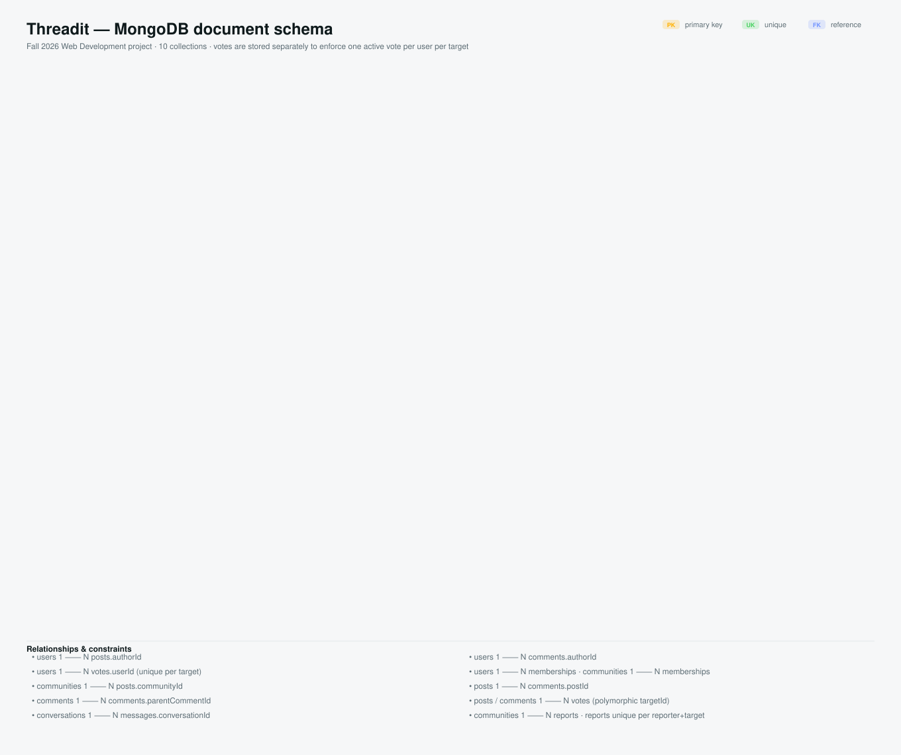
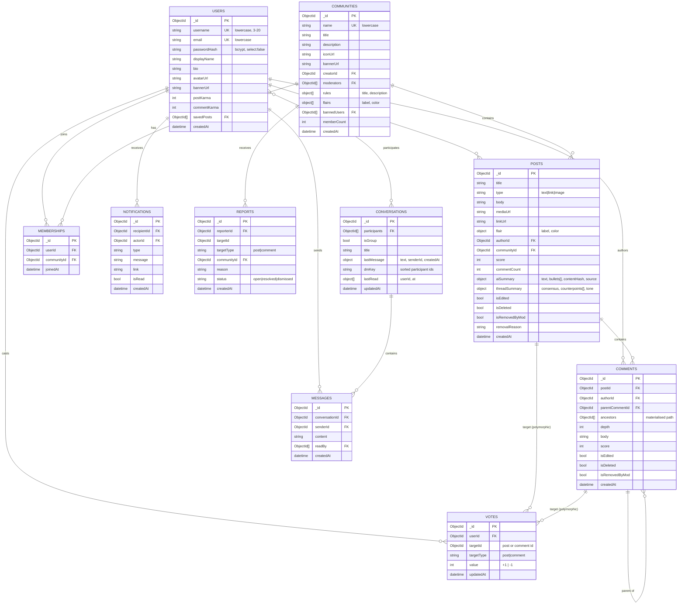

# Database Schema Diagram (Deliverable 2)

MongoDB document model for **Threadit**. Every collection uses ObjectId primary keys. The `votes` collection is separate from posts/comments on purpose: a unique compound index is the storage-level guarantee behind the “one vote per user per target” rule.



> The SVG above is generated from `scripts/render-schema.mjs` with `npm run schema:svg`; the Mermaid source below renders directly on GitHub.

## ERD (Mermaid)



## Index reference

| Collection | Index | Why |
| --- | --- | --- |
| users | `{ username: 1 } unique` | Login/profile lookup, race-safe registration |
| users | `{ email: 1 } unique` | Login, race-safe registration |
| users | text `username, displayName` | Profile/mention search |
| communities | `{ name: 1 } unique` | Community URLs, race-safe creation |
| communities | text `name, description` | Community search |
| memberships | `{ userId: 1, communityId: 1 } unique` | One membership per user; concurrent joins |
| posts | `{ communityId: 1, createdAt: -1 }` | Community “New” feed |
| posts | `{ communityId: 1, score: -1 }` | Community “Top” feed |
| posts | `{ score: -1 }`, `{ createdAt: -1 }` | Global feeds |
| comments | `{ postId: 1, parentCommentId: 1, createdAt: 1 }` | Thread fetch/grouping |
| comments | `{ postId: 1, ancestors: 1 }` | Materialised-path subtree reads |
| votes | `{ userId: 1, targetId: 1, targetType: 1 } unique` | **Voting rule enforcement** |
| votes | `{ targetId: 1, targetType: 1, value: 1 }` | Score reconciliation / audits |
| conversations | `{ participants: 1, updatedAt: -1 }` | Chat inbox |
| conversations | `{ dmKey: 1 }` | Reuse existing 1-on-1 thread |
| messages | `{ conversationId: 1, createdAt: -1 }` | Paginated history |
| notifications | `{ recipientId: 1, isRead: 1, createdAt: -1 }` | Bell unread counts |
| reports | `{ communityId: 1, status: 1, createdAt: -1 }` | Moderator queue |
| reports | `{ reporterId: 1, targetId: 1, targetType: 1 } unique` | One report per user/target |

## Invariants

1. **Voting rule:** at most one `votes` document per `(userId, targetId, targetType)`.
2. **Score integrity:** `posts.score` / `comments.score` equals the sum of active vote values. Enforced by applying only exact deltas inside the same transaction as the vote write.
3. **Karma integrity:** author `postKarma` / `commentKarma` moves by the same delta in the same transaction.
4. **Membership count:** `communities.memberCount` changes by exactly ±1 with the corresponding membership document, inside a transaction.
5. **Comment count:** increments atomically with comment creation (`$inc` in the same transaction).
6. **Thread integrity:** comments are soft-deleted; parents remain as `[deleted]`/`[removed by moderator]` so replies keep their place.

## Transaction boundary

```
withTransaction(
  votes.insertOne | updateOne | deleteOne
  posts.findOneAndUpdate({ $inc: { score: delta } })
  users.updateOne({ $inc: { postKarma: delta } })
)
```

Retries: `WriteConflict` (112), `DuplicateKey` (11000), `TransientTransactionError`; 5 attempts with 15–50 ms jitter.
